# Audit de cohérence esthétique des bâtiments

Généré par `tools/audit_esthetique.js --md` (charte : `docs/STYLE_BATIMENTS.md`). Chaque bâtiment est rendu seul (zoom 1, dpr 2) dans un canevas instrumenté et mesuré :
**Déf.** = px source par px écran au zoom proche (zoom 1,4 × dpr 2, vue rapprochée du centre ; < 0,6 = image agrandie plus de 1,7 fois, floue) ; **Arêtes** = part des pixels à fort gradient (détail) ; **Aplats** = part des blocs 6 × 6 sans variation ; **Sat.** = part de pixels vifs (saturation > 0,6, hors teintes de terre : brique, tuile, bois ; charte ≤ 15 %) ; **Débord** = part de la silhouette hors de la colonne de l'emprise ; **Rempl.** = largeur de la silhouette / largeur du losange ; **Δbas** = bas de la silhouette au droit du sommet avant, en TH.
Critique = repli vectoriel ou atlas, aplat sans détail (arêtes < 0,1 et aplats > 55 %), sous-définition, débord > 6 %, bas de la silhouette à plus de 0,3 TH du sommet avant de l'emprise, ou case 1 × 1 remplie à moins de 55 %. À surveiller = couleurs vives > 15 % (verre bleuté, colza en fleur, bois rouge scandinave sont réalistes : jugé à l'œil).

Bilan : 148 éléments, **26 critiques**. Hauteur médiane d'un étage (immeubles de la ville) : 32.8 px monde ×2.

## Cas critiques

| Élément | Rendu | Sprite | Motif | Vignette |
|---|---|---|---|---|
| Entrepôt logistique en ligne (`ewh`) | HD | entrepot | sous-défini (0.54) | 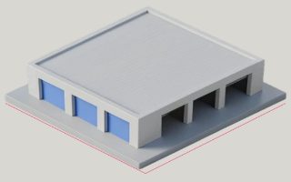 |
| Centrale électrique (`plant`) | HD | centrale_charbon | calage (débord 0 %, remplissage 0.67, Δbas -0.45 TH) | 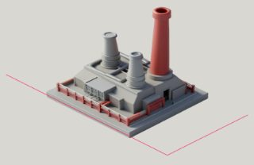 |
| Centrale solaire (`solar`) | HD | centrale_solaire | sous-défini (0.32) ; saturé 70 % ; calage (débord 0 %, remplissage 0.99, Δbas -1.55 TH) | 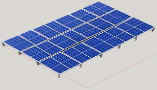 |
| Pylône / ligne aérienne (`pylon`) | HD | pylone_electrique | sous-défini (0.54) | 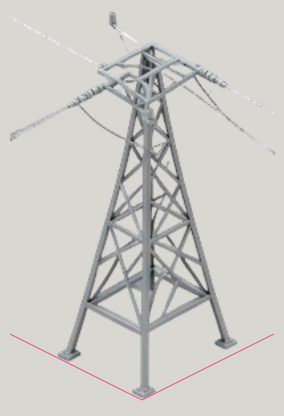 |
| Data center (niveau 0) (`dc:n0`) | HD | data_center_campus | calage (débord 0 %, remplissage 0.89, Δbas -0.33 TH) | 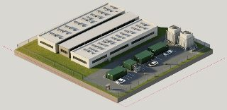 |
| Data center (niveau 2) (`dc:n2`) | HD | data_center | aplat sans détail ; sous-défini (0.31) ; calage (débord 0 %, remplissage 0.89, Δbas -0.46 TH) | 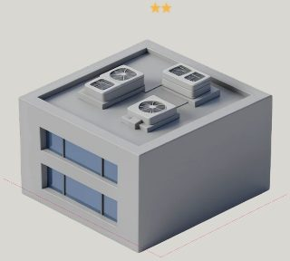 |
| Data center (niveau 4) (`dc:n4`) | HD | data_center | aplat sans détail ; sous-défini (0.31) ; calage (débord 0 %, remplissage 0.89, Δbas -0.46 TH) | 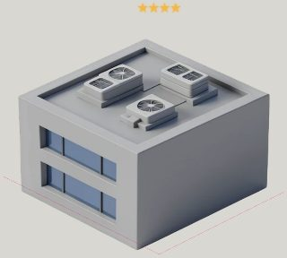 |
| Siège social (niveau 0) (`hq:n0`) | HD | siege_hq_n1 | calage (débord 0 %, remplissage 0.57, Δbas -0.44 TH) | 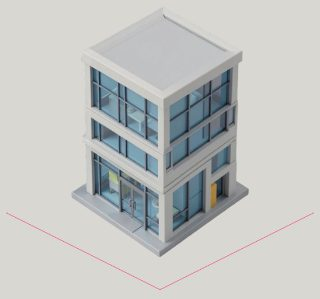 |
| Ferme de blé (`fwheat`) | HD | fwheat | aplat sans détail | 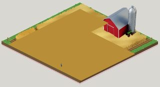 |
| Entreprise de BTP (`btp`) | HD | chantier_moyen | calage (débord 0 %, remplissage 0.67, Δbas -0.48 TH) | 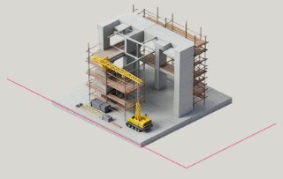 |
| Usine moyenne (`f2`) | HD | usine_moyenne_f2 | calage (débord 0 %, remplissage 0.67, Δbas -0.49 TH) | 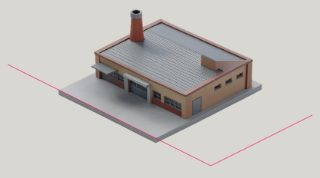 |
| Grande usine (`f3`) | HD | usine_moyenne_f2 | calage (débord 0 %, remplissage 0.75, Δbas -0.49 TH) | 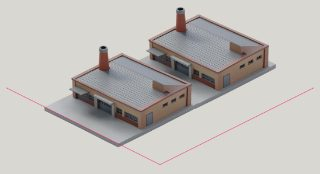 |
| Supermarché (niveau 0) (`s2:n0`) | HD | bat_supermarche | sous-défini (0.59) | 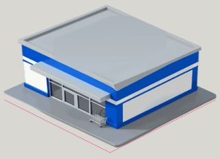 |
| Hypermarché (niveau 0) (`s3:n0`) | HD | bat_hypermarche | sous-défini (0.5) ; saturé 16 % | 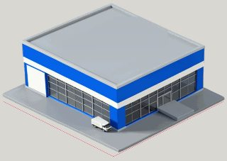 |
| Hypermarché (niveau 2) (`s3:n2`) | HD | bat_hypermarche_n2 | sous-défini (0.56) | 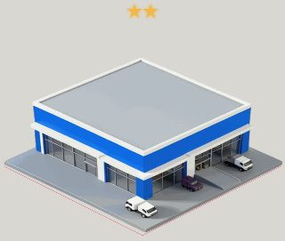 |
| Méga-centre commercial (niveau 0) (`s4:n0`) | HD | bat_mega_centre_commercial | sous-défini (0.56) | 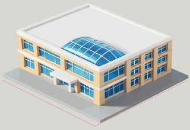 |
| Méga-centre commercial (niveau 2) (`s4:n2`) | HD | bat_mega_centre_commercial | sous-défini (0.56) |  |
| Méga-centre commercial (niveau 4) (`s4:n4`) | HD | bat_mega_centre_commercial | sous-défini (0.56) | 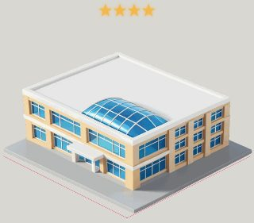 |
| Maison du Numérique (`stech`) | HD | boutique_high_tech | calage (débord 0 %, remplissage 0.67, Δbas -0.43 TH) | 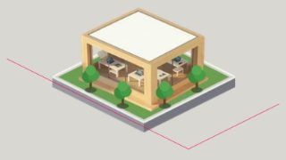 |
| Maison et déco (`shome`) | HD | maison_deco | calage (débord 0 %, remplissage 0.67, Δbas -0.46 TH) | 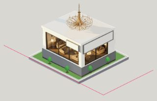 |
| Sport et loisirs (`ssport`) | HD | sport_loisirs | calage (débord 0 %, remplissage 0.67, Δbas -0.46 TH) | 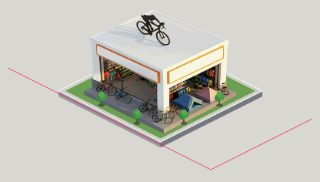 |
| Brico et outillage (`sbrico`) | VECTORIEL |  | repli vectoriel | 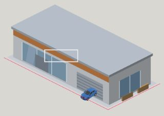 |
| stadium (`mon:stadium`) | HD | stade_sport | sous-défini (0.54) ; saturé 23 % |  |
| stadium2 (`mon:stadium2`) | HD | stade_sport | sous-défini (0.54) ; saturé 23 % | 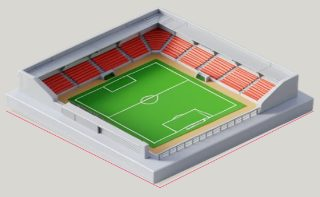 |
| Mall central (`mon:mall`) | VECTORIEL |  | repli vectoriel | 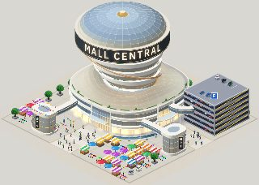 |
| Aéroport (`mon:air`) | VECTORIEL |  | repli vectoriel | 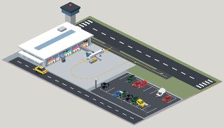 |

## Bâtiments du joueur

| Élément | Rendu | Sprite | Déf. | Arêtes | Aplats | Sat. | Débord | Rempl. | Δbas | État |
|---|---|---|---|---|---|---|---|---|---|---|
| Logements (niveau 0) (`res:n0`) | HD | maison_n1 | 1.07 | 0.456 | 3 % | 10 % | 0 % | 1 | -0.06 | ok |
| Logements (niveau 2) (`res:n2`) | HD | immeuble_n1 | 1.07 | 0.323 | 21 % | 0 % | 0 % | 1 | -0.02 | ok |
| Logements (niveau 4) (`res:n4`) | HD | tour_logements | 1.07 | 0.365 | 11 % | 0 % | 0 % | 0.99 | -0.02 | ok |
| Tour Tech (niveau 0) (`tech:n0`) | HD | city:immeuble_bureaux_vitre | 0.84 | 0.357 | 16 % | 34 % | 0 % | 1 | -0.05 | à surveiller : saturé 34 % |
| Tour Tech (niveau 2) (`tech:n2`) | HD | tour_tech | 1.04 | 0.457 | 4 % | 28 % | 0 % | 1 | -0.02 | à surveiller : saturé 28 % |
| Tour Tech (niveau 4) (`tech:n4`) | HD | tour_tech | 1.04 | 0.457 | 4 % | 28 % | 0 % | 1 | -0.02 | à surveiller : saturé 28 % |
| Entrepôt (`wh`) | HD | entrepot | 1.08 | 0.13 | 26 % | 0 % | 0 % | 1 | -0.05 | ok |
| Entrepôt logistique en ligne (`ewh`) | HD | entrepot | 0.54 | 0.071 | 41 % | 0 % | 0 % | 1 | -0.1 | **sous-défini (0.54)** |
| Centrale électrique (`plant`) | HD | centrale_charbon | 1.48 | 0.343 | 8 % | 3 % | 0 % | 0.67 | -0.45 | **calage (débord 0 %, remplissage 0.67, Δbas -0.45 TH)** |
| Centrale solaire (`solar`) | HD | centrale_solaire | 0.32 | 0.46 | 5 % | 70 % | 0 % | 0.99 | -1.55 | **sous-défini (0.32) ; saturé 70 % ; calage (débord 0 %, remplissage 0.99, Δbas -1.55 TH)** |
| Éolienne (`wind`) | HD | eolienne | 0.81 | 0.1 | 16 % | 0 % | 0 % | 1 | -0.08 | ok |
| Centrale nucléaire (`nuclear`) | HD | centrale_nucleaire | 0.64 | 0.121 | 30 % | 0 % | 0 % | 0.99 | -0.08 | ok |
| Pylône / ligne aérienne (`pylon`) | HD | pylone_electrique | 0.54 | 0.38 | 0 % | 0 % | 0 % | 1 | -0.02 | **sous-défini (0.54)** |
| Centre de R&D (`rd`) | HD | centre_rd | 1.08 | 0.26 | 15 % | 0 % | 0 % | 1 | -0.05 | ok |
| Data center (niveau 0) (`dc:n0`) | HD | data_center_campus | 0.77 | 0.237 | 19 % | 6 % | 0 % | 0.89 | -0.33 | **calage (débord 0 %, remplissage 0.89, Δbas -0.33 TH)** |
| Data center (niveau 2) (`dc:n2`) | HD | data_center | 0.31 | 0.051 | 68 % | 0 % | 0 % | 0.89 | -0.46 | **aplat sans détail ; sous-défini (0.31) ; calage (débord 0 %, remplissage 0.89, Δbas -0.46 TH)** |
| Data center (niveau 4) (`dc:n4`) | HD | data_center | 0.31 | 0.05 | 68 % | 0 % | 0 % | 0.89 | -0.46 | **aplat sans détail ; sous-défini (0.31) ; calage (débord 0 %, remplissage 0.89, Δbas -0.46 TH)** |
| Siège social (niveau 0) (`hq:n0`) | HD | siege_hq_n1 | 0.94 | 0.23 | 28 % | 0 % | 0 % | 0.57 | -0.44 | **calage (débord 0 %, remplissage 0.57, Δbas -0.44 TH)** |
| Siège social (niveau 2) (`hq:n2`) | HD | siege_hq_n2 | 1.14 | 0.485 | 5 % | 1 % | 0 % | 1 | -0.09 | ok |
| Siège social (niveau 4) (`hq:n4`) | HD | siege_hq_n3 | 1.05 | 0.454 | 3 % | 2 % | 0 % | 0.99 | -0.11 | ok |
| Banque (niveau 0) (`bank:n0`) | HD | banque | 1.09 | 0.203 | 26 % | 0 % | 0 % | 0.99 | -0.05 | ok |
| Banque (niveau 2) (`bank:n2`) | HD | banque | 1.09 | 0.197 | 27 % | 3 % | 0 % | 0.99 | -0.05 | ok |
| Banque (niveau 4) (`bank:n4`) | HD | banque | 1.09 | 0.192 | 27 % | 5 % | 0 % | 0.99 | -0.05 | ok |
| Puits pétrole (`well`) | HD | puits_petrole | 0.94 | 0.255 | 14 % | 0 % | 0 % | 1 | -0.14 | ok |
| Mine de fer (`miron`) | HD | mine_fer | 1.08 | 0.474 | 0 % | 0 % | 0 % | 1 | -0.03 | ok |
| Mine charbon (`mcoal`) | HD | mine_charbon | 1.09 | 0.588 | 1 % | 0 % | 0 % | 0.99 | -0.11 | ok |
| Mine cuivre (niveau 0) (`mcopper:n0`) | HD | mine_cuivre | 1.08 | 0.669 | 0 % | 24 % | 0 % | 1 | -0.05 | à surveiller : saturé 24 % |
| Mine cuivre (niveau 2) (`mcopper:n2`) | HD | mine_cuivre_niveau3 | 1.09 | 0.337 | 2 % | 20 % | 0 % | 0.99 | -0.04 | à surveiller : saturé 20 % |
| Mine cuivre (niveau 4) (`mcopper:n4`) | HD | mine_cuivre_niveau3 | 1.09 | 0.32 | 4 % | 24 % | 0 % | 0.99 | -0.04 | à surveiller : saturé 24 % |
| Mine d'or (`mgold`) | HD | mine_or | 1.09 | 0.332 | 8 % | 3 % | 0 % | 1 | -0.06 | ok |
| Mine de nickel-chrome (`mnicr`) | HD | mine_nickel_chrome | 1.08 | 0.488 | 1 % | 0 % | 0 % | 1 | -0.08 | ok |
| Mine de bauxite (`mbauxite`) | HD | mine_bauxite | 1.09 | 0.18 | 22 % | 5 % | 0 % | 0.99 | -0.02 | ok |
| Mine de lithium (`mlithium`) | HD | mine_lithium | 1.08 | 0.322 | 13 % | 8 % | 0 % | 1 | -0.03 | ok |
| Mine de zinc (`mzinc`) | HD | mine_zinc | 1.09 | 0.496 | 4 % | 0 % | 0 % | 0.99 | -0.16 | ok |
| Mine de graphite (`mgraphite`) | HD | mine_graphite | 1.09 | 0.356 | 11 % | 0 % | 0 % | 0.99 | -0.03 | ok |
| Puits de gaz naturel (`gwell`) | HD | puits_gaz | 0.94 | 0.202 | 15 % | 31 % | 0 % | 0.99 | -0.14 | à surveiller : saturé 31 % |
| Carrière de silice (`qsilica`) | HD | carriere_silice | 1.08 | 0.203 | 32 % | 0 % | 0 % | 0.99 | -0.14 | ok |
| Carrière d'argile (`qclay`) | HD | carriere_argile | 1.09 | 0.227 | 25 % | 0 % | 0 % | 0.99 | -0.04 | ok |
| Mine de sel gemme (`qsalt`) | HD | mine_sel | 1.09 | 0.212 | 29 % | 0 % | 0 % | 1 | -0.11 | ok |
| Mine de phosphate (`mphos`) | HD | mine_phosphate | 1.08 | 0.22 | 11 % | 0 % | 0 % | 1 | -0.04 | ok |
| Mine de potasse (`mpotash`) | HD | mine_potasse | 1.09 | 0.193 | 16 % | 1 % | 0 % | 0.99 | -0.05 | ok |
| Ferme de blé (`fwheat`) | HD | fwheat | 0.69 | 0.07 | 72 % | 3 % | 0 % | 1 | -0.04 | **aplat sans détail** |
| Plantation de canne (`fsugar`) | HD | fsugar | 0.69 | 0.173 | 24 % | 54 % | 0 % | 1 | -0.04 | à surveiller : saturé 54 % |
| Plantation de coton (`fcotton`) | HD | fcotton | 0.69 | 0.289 | 10 % | 6 % | 0 % | 1 | -0.04 | ok |
| Plantation d'hévéas (`frubber`) | HD | frubber | 0.69 | 0.125 | 42 % | 5 % | 0 % | 1 | -0.04 | ok |
| Vignoble (`fvine`) | HD | fvine | 0.69 | 0.368 | 14 % | 15 % | 0 % | 1 | -0.04 | ok |
| Culture de maïs (`fcorn`) | HD | fcorn | 0.69 | 0.138 | 32 % | 11 % | 0 % | 1 | -0.04 | ok |
| Culture de colza (`frapeseed`) | HD | frapeseed | 0.69 | 0.106 | 67 % | 80 % | 0 % | 1 | -0.04 | à surveiller : saturé 80 % |
| Élevage de bovins (`fcattle`) | HD | fcattle, auge_foin | 0.69 | 0.308 | 19 % | 0 % | 0 % | 1 | -0.03 | ok |
| Élevage de poulets (`fchicken`) | HD | fchicken | 0.69 | 0.28 | 27 % | 0 % | 0 % | 1 | -0.03 | ok |
| Élevage de porcs (`fpig`) | HD | fpig, auge_foin | 0.69 | 0.313 | 18 % | 0 % | 0 % | 1 | -0.03 | ok |
| Élevage de moutons (`fsheep`) | HD | fsheep, balles_foin | 0.69 | 0.365 | 13 % | 0 % | 0 % | 1 | -0.03 | ok |
| Camp bûcherons (`logging`) | HD | camp_bucherons | 1.08 | 0.57 | 0 % | 0 % | 0 % | 1 | -0.03 | ok |
| Carrière de granulats (`qgravel`) | HD | carriere | 1.08 | 0.525 | 0 % | 0 % | 0 % | 1 | -0.05 | ok |
| Carrière calcaire (`qlime`) | HD | carriere | 1.08 | 0.525 | 0 % | 0 % | 0 % | 1 | -0.05 | ok |
| Entreprise de BTP (`btp`) | HD | chantier_moyen | 1.31 | 0.395 | 5 % | 2 % | 0 % | 0.67 | -0.48 | **calage (débord 0 %, remplissage 0.67, Δbas -0.48 TH)** |
| Agence immobilière (`immo`) | HD | agence_immo | 0.88 | 0.155 | 34 % | 0 % | 0 % | 0.99 | -0.05 | ok |
| Fonderie d'or (`foundry`) | HD | fonderie | 1.09 | 0.312 | 3 % | 2 % | 0 % | 1 | -0.06 | ok |
| Petite usine (`f1`) | HD | usine_moyenne_f2 | 2.3 | 0.39 | 1 % | 0 % | 0 % | 0.8 | -0.1 | ok |
| Usine moyenne (`f2`) | HD | usine_moyenne_f2 | 1.84 | 0.367 | 4 % | 0 % | 0 % | 0.67 | -0.49 | **calage (débord 0 %, remplissage 0.67, Δbas -0.49 TH)** |
| Grande usine (`f3`) | HD | usine_moyenne_f2 | 1.84 | 0.397 | 4 % | 0 % | 0 % | 0.75 | -0.49 | **calage (débord 0 %, remplissage 0.75, Δbas -0.49 TH)** |
| Petit marché (niveau 0) (`s1:n0`) | HD | petit_marche_n1 | 0.87 | 0.18 | 36 % | 5 % | 0 % | 1 | -0.04 | ok |
| Petit marché (niveau 2) (`s1:n2`) | HD | petit_marche_n2 | 0.91 | 0.25 | 20 % | 3 % | 0 % | 0.99 | -0.07 | ok |
| Petit marché (niveau 4) (`s1:n4`) | HD | petit_marche_n2 | 0.91 | 0.244 | 21 % | 6 % | 0 % | 0.99 | -0.07 | ok |
| Supermarché (niveau 0) (`s2:n0`) | HD | bat_supermarche | 0.59 | 0.118 | 58 % | 15 % | 0 % | 1 | -0.14 | **sous-défini (0.59)** |
| Supermarché (niveau 2) (`s2:n2`) | HD | bat_supermarche_n2 | 0.68 | 0.204 | 45 % | 12 % | 0 % | 0.99 | -0.16 | ok |
| Supermarché (niveau 4) (`s2:n4`) | HD | bat_supermarche_n3 | 0.75 | 0.245 | 37 % | 14 % | 0 % | 1 | -0.17 | ok |
| Hypermarché (niveau 0) (`s3:n0`) | HD | bat_hypermarche | 0.5 | 0.118 | 59 % | 16 % | 0 % | 1 | -0.17 | **sous-défini (0.5) ; saturé 16 %** |
| Hypermarché (niveau 2) (`s3:n2`) | HD | bat_hypermarche_n2 | 0.56 | 0.122 | 53 % | 14 % | 0 % | 1 | -0.09 | **sous-défini (0.56)** |
| Hypermarché (niveau 4) (`s3:n4`) | HD | bat_hypermarche_n3 | 0.62 | 0.193 | 43 % | 14 % | 0 % | 0.99 | -0.26 | ok |
| Terminal portuaire (`port`) | HD | terminal_portuaire | 0.88 | 0.13 | 32 % | 0 % | 0 % | 1 | -0.16 | ok |
| Tour de location (niveau 0) (`off:n0`) | HD | tour_bureaux | 1.07 | 0.365 | 12 % | 2 % | 0 % | 0.99 | -0.02 | ok |
| Tour de location (niveau 2) (`off:n2`) | HD | tour_bureaux | 1.07 | 0.365 | 12 % | 2 % | 0 % | 0.99 | -0.02 | ok |
| Tour de location (niveau 4) (`off:n4`) | HD | tour_bureaux | 1.07 | 0.365 | 12 % | 2 % | 0 % | 0.99 | -0.02 | ok |
| Station média (`tv`) | HD | station_tv | 1.09 | 0.267 | 15 % | 0 % | 0 % | 0.99 | -0.07 | ok |
| Équipement sportif (`sport`) | HD | stade_sport | 1.08 | 0.4 | 7 % | 24 % | 0 % | 1 | -0.04 | à surveiller : saturé 24 % |
| Méga-usine (`f4`) | HD | usine_f4_mega | 0.83 | 0.362 | 11 % | 0 % | 0 % | 1 | -0.12 | ok |
| Méga-centre commercial (niveau 0) (`s4:n0`) | HD | bat_mega_centre_commercial | 0.56 | 0.163 | 44 % | 9 % | 0 % | 1 | -0.19 | **sous-défini (0.56)** |
| Méga-centre commercial (niveau 2) (`s4:n2`) | HD | bat_mega_centre_commercial | 0.56 | 0.163 | 44 % | 9 % | 0 % | 1 | -0.19 | **sous-défini (0.56)** |
| Méga-centre commercial (niveau 4) (`s4:n4`) | HD | bat_mega_centre_commercial | 0.56 | 0.162 | 45 % | 9 % | 0 % | 1 | -0.19 | **sous-défini (0.56)** |
| Concession automobile (`sauto`) | HD | concession_auto | 0.69 | 0.319 | 19 % | 1 % | 0 % | 1 | -0.02 | ok |
| Maison du Numérique (`stech`) | HD | boutique_high_tech | 0.69 | 0.28 | 28 % | 0 % | 0 % | 0.67 | -0.43 | **calage (débord 0 %, remplissage 0.67, Δbas -0.43 TH)** |
| Maison de luxe (`slux`) | HD | boutique_luxe | 0.7 | 0.359 | 14 % | 0 % | 0 % | 1 | -0.02 | ok |
| Boutique de mode (`smode`) | HD | boutique_mode_luxe | 0.7 | 0.322 | 24 % | 0 % | 0 % | 1 | -0.02 | ok |
| Pharmacie · drugstore (`spharma`) | HD | pharmacie_quartier | 0.81 | 0.405 | 6 % | 0 % | 0 % | 1 | -0.02 | ok |
| Maison et déco (`shome`) | HD | maison_deco | 1.38 | 0.338 | 24 % | 0 % | 0 % | 0.67 | -0.46 | **calage (débord 0 %, remplissage 0.67, Δbas -0.46 TH)** |
| Sport et loisirs (`ssport`) | HD | sport_loisirs | 1.38 | 0.37 | 14 % | 1 % | 0 % | 0.67 | -0.46 | **calage (débord 0 %, remplissage 0.67, Δbas -0.46 TH)** |
| Brico et outillage (`sbrico`) | VECTORIEL |  |  | 0.104 | 67 % | 1 % | 0 % | 0.95 | -0.05 | **repli vectoriel** |
| Station-service (`sfuel`) | HD | station_service | 0.67 | 0.153 | 47 % | 52 % | 0 % | 0.99 | -0.07 | à surveiller : saturé 52 % |
| Bornes de recharge (`scharge`) | HD | station_recharge_electrique | 0.67 | 0.324 | 19 % | 17 % | 0 % | 1 | -0.04 | à surveiller : saturé 17 % |

## Équipements publics

| Élément | Rendu | Sprite | Déf. | Arêtes | Aplats | Sat. | Débord | Rempl. | Δbas | État |
|---|---|---|---|---|---|---|---|---|---|---|
| hospital (`mon:hospital`) | HD | hopital_ville | 0.81 | 0.192 | 28 % | 0 % | 0 % | 1 | -0.03 | ok |
| lycee (`mon:lycee`) | HD | lycee | 0.81 | 0.337 | 7 % | 0 % | 0 % | 1 | 0.03 | ok |
| college (`mon:college`) | HD | college | 0.81 | 0.356 | 6 % | 0 % | 0 % | 1 | -0.04 | ok |
| maternelle (`mon:maternelle`) | HD | ecole_maternelle | 0.81 | 0.467 | 4 % | 0 % | 0 % | 1 | -0.02 | ok |
| garderie (`mon:garderie`) | HD | creche | 0.81 | 0.309 | 19 % | 0 % | 0 % | 1 | -0.02 | ok |
| police (`mon:police`) | HD | commissariat_ville | 0.81 | 0.319 | 22 % | 0 % | 0 % | 1 | -0.02 | ok |
| fire (`mon:fire`) | HD | caserne_pompiers | 1.08 | 0.26 | 22 % | 0 % | 0 % | 1 | -0.09 | ok |
| hall (`mon:hall`) | HD | hotel_de_ville | 0.81 | 0.287 | 9 % | 0 % | 0 % | 1 | -0.03 | ok |
| telecom (`mon:telecom`) | HD | station_tv | 1.09 | 0.267 | 15 % | 0 % | 0 % | 0.99 | -0.07 | ok |
| stadium (`mon:stadium`) | HD | stade_sport | 0.54 | 0.288 | 22 % | 23 % | 0 % | 1 | -0.05 | **sous-défini (0.54) ; saturé 23 %** |
| stadium2 (`mon:stadium2`) | HD | stade_sport | 0.54 | 0.288 | 22 % | 23 % | 0 % | 1 | -0.05 | **sous-défini (0.54) ; saturé 23 %** |

## Services de quartier

| Élément | Rendu | Sprite | Déf. | Arêtes | Aplats | Sat. | Débord | Rempl. | Δbas | État |
|---|---|---|---|---|---|---|---|---|---|---|
| Restaurant en terrasse (`sv:restaurant_terrasse`) | HD | restaurant_quartier | 0.81 | 0.47 | 3 % | 0 % | 0 % | 1 | -0.02 | ok |
| Café de quartier (`sv:cafe_de_quartier`) | HD | cafe_quartier | 0.81 | 0.421 | 16 % | 0 % | 0 % | 1 | -0.02 | ok |
| Boulangerie (`sv:boulangerie`) | HD | boulangerie_quartier | 0.81 | 0.492 | 5 % | 0 % | 0 % | 1 | -0.02 | ok |
| Boutique de mode (`sv:boutique_mode`) | HD | boutique_quartier | 0.81 | 0.383 | 6 % | 0 % | 0 % | 1 | -0.02 | ok |
| Pharmacie (`sv:drugstore`) | HD | pharmacie_quartier | 0.81 | 0.405 | 6 % | 0 % | 0 % | 1 | -0.02 | ok |
| Barre HLM (`sv:barre_hlm`) | HD | barre_hlm | 1.02 | 0.345 | 28 % | 3 % | 0 % | 0.99 | -0.05 | ok |
| Immeuble en construction (`sv:immeuble_en_construction`) | HD | immeuble_en_construction | 0.84 | 0.516 | 1 % | 4 % | 0 % | 1 | -0.04 | ok |
| Église (`sv:eglise_de_village`) | HD | eglise_de_village | 0.67 | 0.663 | 0 % | 0 % | 0 % | 0.99 | -0.05 | ok |
| Immeuble abandonné (friche) (`sv:batiment_abandonne`) | HD | batiment_abandonne | 1.06 | 0.363 | 1 % | 0 % | 0 % | 0.99 | -0.01 | ok |
| station_service (`sv:station_service`) | HD | station_service | 0.67 | 0.153 | 47 % | 52 % | 0 % | 0.99 | -0.07 | à surveiller : saturé 52 % |
| station_recharge_electrique (`sv:station_recharge_electrique`) | HD | station_recharge_electrique | 0.67 | 0.324 | 19 % | 17 % | 0 % | 1 | -0.04 | à surveiller : saturé 17 % |

## Ville (PNJ) au démarrage

| Élément | Rendu | Sprite | Déf. | Arêtes | Aplats | Sat. | Débord | Rempl. | Δbas | État |
|---|---|---|---|---|---|---|---|---|---|---|
| barre_hlm (res, 3 ét.) × 4 (`npc:barre_hlm`) | HD | barre_hlm | 1.02 | 0.345 | 28 % | 3 % | 0 % | 0.99 | -0.05 | ok |
| batiment_abandonne (house, 1 ét.) × 1 (`npc:batiment_abandonne`) | HD | batiment_abandonne | 1.06 | 0.363 | 1 % | 0 % | 0 % | 0.99 | -0.01 | ok |
| boulangerie_quartier (res, 5 ét.) × 3 (`npc:boulangerie_quartier`) | HD | boulangerie_quartier | 0.81 | 0.492 | 5 % | 0 % | 0 % | 1 | -0.02 | ok |
| boutique_quartier (res, 4 ét.) × 3 (`npc:boutique_quartier`) | HD | boutique_quartier | 0.81 | 0.383 | 6 % | 0 % | 0 % | 1 | -0.02 | ok |
| cafe_quartier (res, 5 ét.) × 3 (`npc:cafe_quartier`) | HD | cafe_quartier | 0.81 | 0.421 | 16 % | 0 % | 0 % | 1 | -0.02 | ok |
| city:banque_neoclassique (off, 4 ét.) × 1 (`npc:city:banque_neoclassique`) | HD | city:banque_neoclassique | 0.84 | 0.442 | 10 % | 16 % | 0 % | 1 | -0.03 | à surveiller : saturé 16 % |
| city:brownstone_new_yorkais (res, 4 ét.) × 13 (`npc:city:brownstone_new_yorkais`) | HD | city:brownstone_new_yorkais | 0.67 | 0.417 | 12 % | 1 % | 0 % | 0.99 | -0.03 | ok |
| city:chalet_savoyard (house, 1 ét.) × 24 (`npc:city:chalet_savoyard`) | HD | city:chalet_savoyard | 0.67 | 0.511 | 1 % | 3 % | 0 % | 0.99 | -0.05 | ok |
| city:immeuble_art_deco (res, 4 ét.) × 14 (`npc:city:immeuble_art_deco`) | HD | city:immeuble_art_deco | 0.67 | 0.465 | 18 % | 2 % | 0 % | 0.99 | -0.03 | ok |
| city:immeuble_bureaux_vitre (off, 4 ét.) × 3 (`npc:city:immeuble_bureaux_vitre`) | HD | city:immeuble_bureaux_vitre | 0.84 | 0.355 | 17 % | 34 % | 0 % | 1 | -0.05 | à surveiller : saturé 34 % |
| city:immeuble_haussmannien (res, 4 ét.) × 15 (`npc:city:immeuble_haussmannien`) | HD | city:immeuble_haussmannien | 0.84 | 0.567 | 2 % | 1 % | 0 % | 1 | -0.02 | ok |
| city:immeuble_londonien_briques (res, 3 ét.) × 25 (`npc:city:immeuble_londonien_briques`) | HD | city:immeuble_londonien_briques | 0.67 | 0.404 | 12 % | 2 % | 0 % | 0.99 | -0.05 | ok |
| city:immeuble_residentiel_6_etages_a (res, 6 ét.) × 1 (`npc:city:immeuble_residentiel_6_etages_a`) | HD | city:immeuble_residentiel_6_etages_a | 0.92 | 0.371 | 19 % | 2 % | 0 % | 1 | -0.05 | ok |
| city:immeuble_residentiel_6_etages_b (res, 6 ét.) × 2 (`npc:city:immeuble_residentiel_6_etages_b`) | HD | city:immeuble_residentiel_6_etages_b | 0.9 | 0.535 | 0 % | 3 % | 0 % | 1 | -0.05 | ok |
| city:immeuble_residentiel_moderne (res, 5 ét.) × 8 (`npc:city:immeuble_residentiel_moderne`) | HD | city:immeuble_residentiel_moderne | 0.84 | 0.474 | 4 % | 9 % | 0 % | 1 | -0.03 | ok |
| city:maison_bois_nordique (house, 1 ét.) × 27 (`npc:city:maison_bois_nordique`) | HD | city:maison_bois_nordique | 0.67 | 0.439 | 1 % | 47 % | 0 % | 0.99 | -0.05 | à surveiller : saturé 47 % |
| city:maison_de_ville_briques (house, 1 ét.) × 37 (`npc:city:maison_de_ville_briques`) | HD | city:maison_de_ville_briques | 0.67 | 0.454 | 11 % | 3 % | 0 % | 1 | -0.05 | ok |
| city:maison_japonaise (house, 1 ét.) × 23 (`npc:city:maison_japonaise`) | HD | city:maison_japonaise | 0.67 | 0.64 | 0 % | 2 % | 0 % | 0.99 | -0.08 | ok |
| city:maison_moderne_cubique (res, 2 ét.) × 32 (`npc:city:maison_moderne_cubique`) | HD | city:maison_moderne_cubique | 0.67 | 0.3 | 26 % | 1 % | 0 % | 0.99 | -0.04 | ok |
| city:pavillon_banlieue (house, 1 ét.) × 31 (`npc:city:pavillon_banlieue`) | HD | city:pavillon_banlieue | 0.67 | 0.552 | 7 % | 26 % | 0 % | 0.99 | -0.09 | à surveiller : saturé 26 % |
| city:tour_bureaux_12_etages_b (off, 14 ét.) × 1 (`npc:city:tour_bureaux_12_etages_b`) | HD | city:tour_bureaux_12_etages_b | 1.04 | 0.432 | 8 % | 20 % | 0 % | 1 | -0.05 | à surveiller : saturé 20 % |
| city:tour_de_verre (off, 14 ét.) × 2 (`npc:city:tour_de_verre`) | HD | city:tour_de_verre | 0.67 | 0.456 | 6 % | 29 % | 0 % | 0.99 | -0.03 | à surveiller : saturé 29 % |
| city:villa_mediterraneenne (house, 1 ét.) × 27 (`npc:city:villa_mediterraneenne`) | HD | city:villa_mediterraneenne | 0.84 | 0.604 | 3 % | 12 % | 0 % | 0.99 | -0.07 | ok |
| eglise_de_village (house, 1 ét.) × 2 (`npc:eglise_de_village`) | HD | eglise_de_village | 0.67 | 0.663 | 0 % | 0 % | 0 % | 0.99 | -0.05 | ok |
| immeuble_en_construction (res, 5 ét.) × 2 (`npc:immeuble_en_construction`) | HD | immeuble_en_construction | 0.84 | 0.517 | 1 % | 4 % | 0 % | 1 | -0.04 | ok |
| immeuble_pnj_a (res, 3 ét.) × 28 (`npc:immeuble_pnj_a`) | HD | immeuble_pnj_a | 1.07 | 0.232 | 28 % | 0 % | 0 % | 1 | -0.03 | ok |
| immeuble_pnj_b (res, 3 ét.) × 13 (`npc:immeuble_pnj_b`) | HD | immeuble_pnj_b | 1.07 | 0.286 | 21 % | 2 % | 0 % | 1 | -0.03 | ok |
| maison_pnj_a (house, 1 ét.) × 16 (`npc:maison_pnj_a`) | HD | maison_pnj_a | 0.91 | 0.333 | 9 % | 0 % | 0 % | 1 | -0.04 | ok |
| maison_pnj_b (house, 1 ét.) × 30 (`npc:maison_pnj_b`) | HD | maison_pnj_b | 1.07 | 0.312 | 15 % | 0 % | 0 % | 1 | -0.06 | ok |
| maison_pnj_c (house, 1 ét.) × 35 (`npc:maison_pnj_c`) | HD | maison_pnj_c | 0.91 | 0.324 | 8 % | 0 % | 0 % | 0.99 | -0.04 | ok |
| parc_urbain (park, 1 ét.) × 33 (`npc:parc_urbain`) | HD | parc_urbain | 1.01 | 0.518 | 0 % | 2 % | 0 % | 1 | -0.03 | ok |
| pharmacie_quartier (res, 5 ét.) × 2 (`npc:pharmacie_quartier`) | HD | pharmacie_quartier | 0.81 | 0.405 | 6 % | 0 % | 0 % | 1 | -0.02 | ok |
| restaurant_quartier (off, 6 ét.) × 3 (`npc:restaurant_quartier`) | HD | restaurant_quartier | 0.81 | 0.47 | 3 % | 0 % | 0 % | 1 | -0.02 | ok |
| tour_pnj_b (off, 15 ét.) × 1 (`npc:tour_pnj_b`) | HD | tour_pnj_b | 1.07 | 0.448 | 7 % | 2 % | 0 % | 0.99 | -0.02 | ok |

## Grands équipements

| Élément | Rendu | Sprite | Déf. | Arêtes | Aplats | Sat. | Débord | Rempl. | Δbas | État |
|---|---|---|---|---|---|---|---|---|---|---|
| Mall central (`mon:mall`) | VECTORIEL |  |  | 0.119 | 50 % | 4 % | 0 % | 1 | -0.02 | **repli vectoriel** |
| Aéroport (`mon:air`) | VECTORIEL |  |  | 0.108 | 66 % | 2 % | 0 % | 1 | -0.02 | **repli vectoriel** |

## Échelle des étages (immeubles de la ville au démarrage)

| Sprite | Cases | px par étage (zoom 1, dpr 2) | Écart à la médiane |
|---|---|---|---|
| immeuble_pnj_a | 28 | 41.3 | 26 % |
| city:immeuble_londonien_briques | 25 | 36.3 | 11 % |
| city:immeuble_haussmannien | 15 | 28.8 | -12 % |
| city:immeuble_art_deco | 14 | 27.3 | -17 % |
| city:maison_de_ville_briques | 13 | 37 | 13 % |
| immeuble_pnj_b | 13 | 49.3 | 50 % **hors échelle** |
| city:brownstone_new_yorkais | 13 | 29.3 | -11 % |
| city:immeuble_residentiel_moderne | 8 | 21.6 | -34 % |
| barre_hlm | 4 | 25.5 | -22 % |
| city:immeuble_bureaux_vitre | 3 | 24.6 | -25 % |
| restaurant_quartier | 3 | 27.3 | -17 % |
| boulangerie_quartier | 3 | 27.3 | -17 % |
| city:pavillon_banlieue | 3 | 48 | 46 % **hors échelle** |
| city:maison_moderne_cubique | 2 | 47 | 43 % |
| immeuble_en_construction | 2 | 28.3 | -14 % |
| boutique_quartier | 2 | 47.3 | 44 % |
| city:tour_de_verre | 2 | 11.4 | -65 % **hors échelle** |
| cafe_quartier | 2 | 41 | 25 % |
| city:immeuble_residentiel_6_etages_b | 2 | 18.7 | -43 % |
| city:immeuble_residentiel_6_etages_a | 1 | 19 | -42 % |
| city:banque_neoclassique | 1 | 23 | -30 % |
| tour_pnj_b | 1 | 19 | -42 % |
| pharmacie_quartier | 1 | 31.8 | -3 % |
| city:tour_bureaux_12_etages_b | 1 | 10.4 | -68 % **hors échelle** |

L'écart d'échelle compare la hauteur dessinée au nombre d'étages *logiques* de la case (économie) : un sprite fixe (maison de ville, immeuble de 6 étages) posé sur une case de 3 ou 12 étages s'écarte mécaniquement ; seuls les écarts > 45 % sont signalés.

Ordre de profondeur : vérifié par `tests/t57_overlap.js` et `tests/t100_occlusion.js` (non répété ici).
